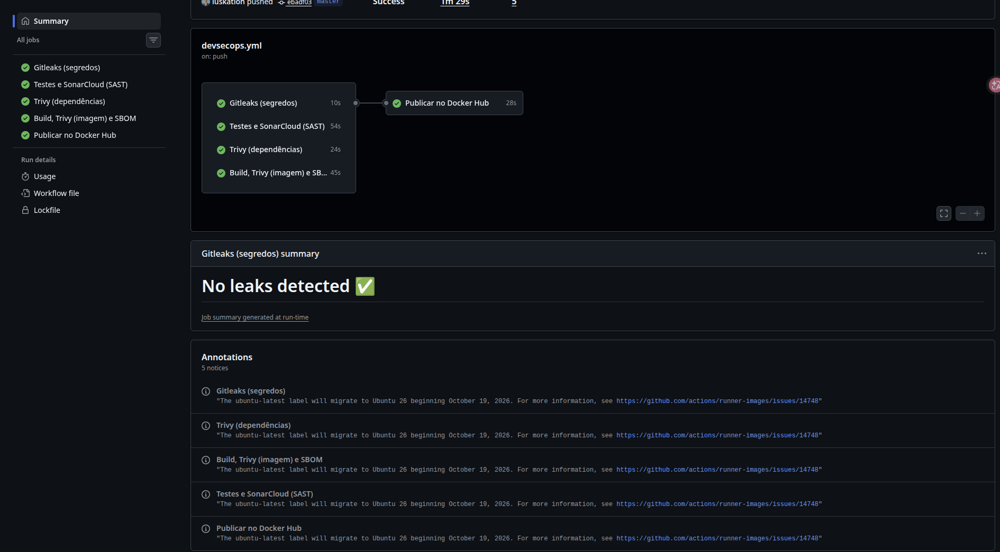
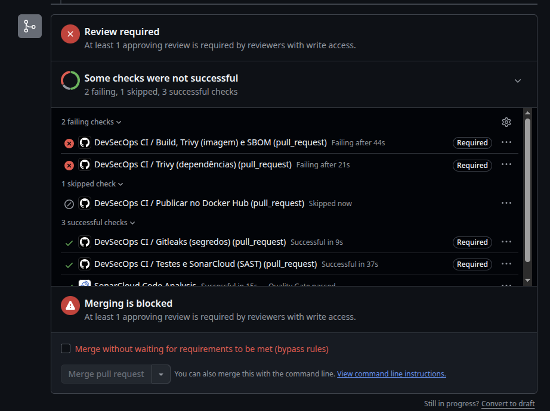
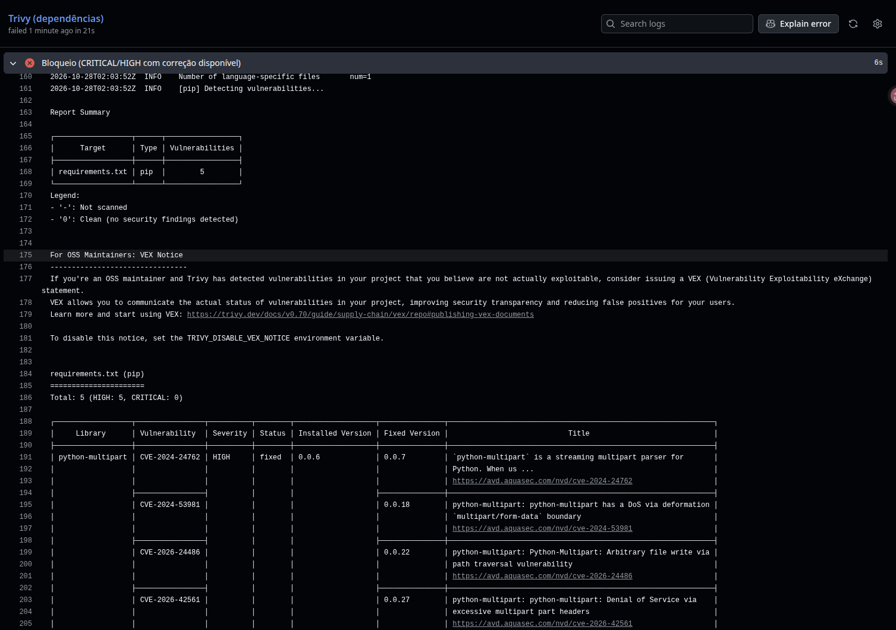
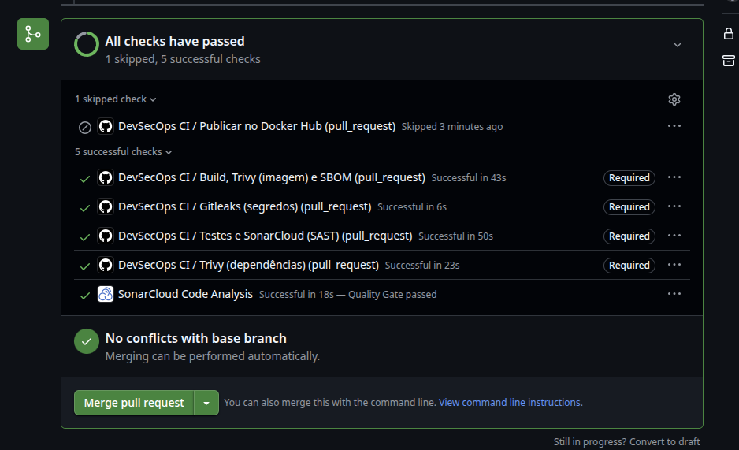

# devops-class

API em FastAPI com um endpoint `GET /hello`, empacotada em Docker e publicada no Docker Hub por uma pipeline do GitHub Actions. A pipeline aplica práticas de **DevSecOps** e **shift-left security**: segredos, código, dependências e imagem são verificados em todo Pull Request, antes de qualquer alteração entrar na `master`.

## Entregáveis

| # | Item | Onde |
|---|------|------|
| 1 | Repositório e workflow YAML | https://github.com/luskation/devops-class · [`.github/workflows/devsecops.yml`](.github/workflows/devsecops.yml) |
| 2 | Execução do pipeline com as ferramentas | [Execução na `master`](https://github.com/luskation/devops-class/actions/runs/40617924311) · [captura](#execução-do-pipeline-na-master) |
| 3 | PR bloqueado e relatório da vulnerabilidade | [PR #2](https://github.com/luskation/devops-class/pull/2) · [capturas](#pull-request-bloqueado) |
| 4 | Execução aprovada após a correção | [Execução corrigida](https://github.com/luskation/devops-class/actions/runs/40618937534) · [captura](#execução-aprovada-após-a-correção) |
| 5 | SBOM | Artifact `sbom` de cada execução · cópia em [`docs/sbom/`](docs/sbom) |
| 6 | Ferramentas, verificações e regras de bloqueio | Este README |

## Aplicação

- `main.py`: endpoint `GET /hello`.
- `tests/test_main.py`: teste unitário do endpoint.
- `requirements.txt`: dependências de execução, com versões fixas, para o Trivy conseguir analisá-las.
- `requirements-dev.txt`: dependências de teste (pytest, pytest-cov, httpx).
- `sonar-project.properties`: configuração do SonarCloud.
- `Dockerfile`: imagem `python:3.11-slim` endurecida:
  - aplica as correções de segurança do sistema (`apt-get upgrade`);
  - remove `pip`, `setuptools`, `wheel` e `ensurepip` depois da instalação, porque não são usados em execução e trazem bibliotecas com CVEs conhecidas;
  - copia só o `main.py` e roda como usuário sem root.

## Pipeline DevSecOps

O workflow `DevSecOps CI` roda automaticamente:

- na **abertura e atualização de Pull Requests** para a `master` (`opened`, `synchronize`, `reopened`);
- em **push na `master`**, quando também publica a imagem.

```
 PR / push
     │
     ├── gitleaks ───────────┐
     ├── sonarcloud ─────────┤
     ├── trivy-deps ─────────┼──► publish (somente push na master)
     └── build ──────────────┘
         (build, teste do container,
          Trivy na imagem, SBOM)
```

### Ferramentas e regras de bloqueio

| Job | Ferramenta | O que verifica | Bloqueia quando |
|-----|-----------|----------------|-----------------|
| `gitleaks` | Gitleaks | Senhas, tokens, chaves e outros segredos em **todo o histórico** do repositório (`fetch-depth: 0`) | Encontrar qualquer possível segredo |
| `sonarcloud` | pytest + SonarCloud | Testes unitários, cobertura e análise estática (SAST): bugs, vulnerabilidades, security hotspots, code smells e duplicação | O teste falhar ou o **Quality Gate** do código novo for reprovado (`sonar.qualitygate.wait=true`) |
| `trivy-deps` | Trivy (`fs`) | Vulnerabilidades nas dependências do `requirements.txt` | Houver CVE **CRITICAL** ou **HIGH** com **correção disponível** (`ignore-unfixed: true`, `exit-code: 1`) |
| `build` | Docker + Trivy (`image`) | Build da imagem, teste do container (`curl /hello`) e vulnerabilidades do sistema operacional e dos pacotes Python da imagem | O build ou o teste falhar, ou houver CVE **CRITICAL/HIGH com correção** na imagem |
| `build` | Syft | Gera o SBOM da imagem com todos os componentes e versões | Não bloqueia |
| `publish` | Docker Hub | Publica a imagem `2.0` e `latest` | Só roda em push na `master` e só se **todos** os jobs acima passarem (`needs`) |

### Relatórios LOW e MEDIUM

O Trivy roda duas vezes em cada alvo:

1. **Relatório** com todas as severidades (`LOW,MEDIUM,HIGH,CRITICAL`) e `exit-code: 0`. Ele aparece no log e é publicado nos artifacts `trivy-deps-report` e `trivy-image-report`. LOW e MEDIUM ficam registrados aqui, sem bloquear.
2. **Bloqueio** só com `HIGH,CRITICAL`, `ignore-unfixed: true` e `exit-code: 1`.

### SBOM

O Syft gera o SBOM da imagem em três formatos, publicados no artifact **`sbom`** de cada execução:

- `sbom.spdx.json` (SPDX)
- `sbom.cyclonedx.json` (CycloneDX)
- `sbom.txt` (tabela legível com nome, versão e tipo de cada componente)

### Publicação segura

Em push na `master`, o job `build` salva a imagem já verificada (`docker save`) e o job `publish` envia **exatamente essa imagem** ao Docker Hub. A imagem publicada é a mesma que passou no teste e no Trivy, sem rebuild. Em Pull Requests o `publish` não roda, então uma versão vulnerável nunca chega ao registry.

## Configuração

### Secrets do repositório

| Secret | Uso |
|--------|-----|
| `DOCKERHUB_USERNAME` / `DOCKERHUB_TOKEN` | Publicação no Docker Hub |
| `SONAR_TOKEN` | Token do SonarCloud (*My Account → Security*) |

O Gitleaks usa o `GITHUB_TOKEN` automático. Repositórios de conta pessoal não precisam de `GITLEAKS_LICENSE`.

### SonarCloud

1. Importar o repositório em https://sonarcloud.io. O `sonar.organization` e o `sonar.projectKey` em `sonar-project.properties` precisam ser iguais aos do projeto criado.
2. Em *Administration → Analysis Method*, desativar a **Automatic Analysis**, porque a análise é feita pelo GitHub Actions.
3. Em *Administration → New Code*, definir o código novo como **Previous version** (ou *Reference branch* = `master`).
4. Manter o Quality Gate **Sonar way**, que avalia o **código novo**: nenhum problema novo, todos os security hotspots revisados, cobertura ≥ 80% e duplicação ≤ 3%.

### Proteção da branch `master`

Em *Settings → Branches → Add branch ruleset* (ou *Branch protection rule*) para `master`:

- **Require a pull request before merging**
- **Require status checks to pass**, marcando:
  - `Gitleaks (segredos)`
  - `Testes e SonarCloud (SAST)`
  - `Trivy (dependências)`
  - `Build, Trivy (imagem) e SBOM`
- **Require branches to be up to date before merging**

Com isso o botão de merge fica bloqueado enquanto qualquer verificação falhar.

## Demonstração do bloqueio e da correção

A demonstração usa a dependência `python-multipart==0.0.6`, que tem CVEs **HIGH** com correção disponível (por exemplo, [CVE-2024-24762](https://avd.aquasec.com/nvd/cve-2024-24762), corrigida na 0.0.7).

```bash
# 1. Branch de teste com a dependência vulnerável
git checkout -b teste/dependencia-vulneravel
echo "python-multipart==0.0.6" >> requirements.txt
git commit -am "test: adiciona dependência vulnerável para demonstrar o bloqueio"
git push -u origin teste/dependencia-vulneravel
# abrir o PR para a master: Trivy falha e o merge fica bloqueado

# 2. Correção na mesma branch
sed -i 's/python-multipart==0.0.6/python-multipart==0.0.32/' requirements.txt
git commit -am "fix: atualiza python-multipart para versão corrigida"
git push
# o PR é reavaliado e todas as verificações passam
```

Trecho esperado do relatório do Trivy no PR bloqueado:

```
Total: 5 (HIGH: 5, CRITICAL: 0)
│ python-multipart │ CVE-2024-24762 │ HIGH │ fixed │ 0.0.6 │ 0.0.7  │ ...
│                  │ CVE-2024-53981 │      │       │       │ 0.0.18 │ ...
│                  │ CVE-2026-24486 │      │       │       │ 0.0.22 │ ...
│                  │ CVE-2026-42561 │      │       │       │ 0.0.27 │ ...
│                  │ CVE-2026-53539 │      │       │       │ 0.0.30 │ ...
```

## Evidências

As capturas ficam em [`docs/evidencias/`](docs/evidencias).

| Execução | Commit | Evento | Gitleaks | SonarCloud | Trivy (deps) | Build + Trivy (imagem) + SBOM | Publicação |
|----------|--------|--------|----------|------------|--------------|-------------------------------|------------|
| [40617924311](https://github.com/luskation/devops-class/actions/runs/40617924311) | `ebadf03` | push na `master` | ✅ | ✅ | ✅ | ✅ | ✅ |
| [40618677554](https://github.com/luskation/devops-class/actions/runs/40618677554) | `ea88e8e` | PR #2 (`python-multipart==0.0.6`) | ✅ | ✅ | ❌ | ❌ | ⏭️ |
| [40618937534](https://github.com/luskation/devops-class/actions/runs/40618937534) | `43fd1a6` | PR #2 (`python-multipart==0.0.32`) | ✅ | ✅ | ✅ | ✅ | ⏭️ |

### Execução do pipeline na master

Os quatro jobs de verificação rodam em paralelo e a publicação no Docker Hub só começa depois que todos passam. O Gitleaks não encontrou segredos no histórico.



### Pull Request bloqueado

Com `python-multipart==0.0.6`, os checks obrigatórios `Trivy (dependências)` e `Build, Trivy (imagem) e SBOM` falham e o merge fica bloqueado. A publicação não roda em PRs, então a versão vulnerável nunca chega ao registry.



Trecho do relatório do Trivy apontando as vulnerabilidades HIGH com correção disponível:



### Execução aprovada após a correção

Depois de atualizar para `python-multipart==0.0.32`, todas as verificações passam no mesmo PR, incluindo o Quality Gate do SonarCloud.



### SBOM

O artifact `sbom` da [execução na `master`](https://github.com/luskation/devops-class/actions/runs/40617924311) foi copiado para [`docs/sbom/`](docs/sbom), porque artifacts do GitHub Actions expiram:

- [`sbom.zip`](docs/sbom/sbom.zip): SPDX (`sbom.spdx.json`), CycloneDX (`sbom.cyclonedx.json`) e tabela (`sbom.txt`)
- [`sbom.txt`](docs/sbom/sbom.txt): tabela com nome, versão e tipo de cada componente da imagem

## Evidências da atividade anterior (Docker CI)


#### Execuções da pipeline

| Execução | Commit | Resultado | Versão publicada |
|----------|--------|-----------|------------------|
| [#2](https://github.com/luskation/devops-no-ia/actions/runs/36506478089) | `bc64dee` | ✅ success | 1.0 |
| [#5](https://github.com/luskation/devops-no-ia/actions/runs/36713886046) | `b3cf3d3` | ✅ success | 2.0 |

#### Tags no Docker Hub

| Tag | Digest |
|-----|--------|
| `1.0` | `sha256:8a23433f91e95038f4a0e4e175c9d8c4a9bed3f7aa2ea262ef1b8d334987cf13` |
| `2.0` | `sha256:14fb6f2dfa989e2a848be65db1c3142a52fd0f5ea860b5a6e39694294a61f8b9` |
| `latest` | igual à `2.0` |

#### Execução local das imagens baixadas do registry

Antes de cada teste, a imagem local foi removida, para garantir que o `docker pull` baixasse a imagem do Docker Hub.

> A aplicação escuta na porta 8000 dentro do container. Por isso o mapeamento é `-p 8080:8000`.

**Versão 1.0: `Hello World`**

```console
$ docker pull luskation/devops-no-ia:1.0
Digest: sha256:8a23433f91e95038f4a0e4e175c9d8c4a9bed3f7aa2ea262ef1b8d334987cf13
Status: Downloaded newer image for luskation/devops-no-ia:1.0

$ docker run -d -p 8080:8000 luskation/devops-no-ia:1.0
8be3b7d52e72

$ curl http://localhost:8080/hello
{"message":"Hello World"}
```

**Versão 2.0: `Hello World 2`**

```console
$ docker pull luskation/devops-no-ia:2.0
Digest: sha256:14fb6f2dfa989e2a848be65db1c3142a52fd0f5ea860b5a6e39694294a61f8b9
Status: Downloaded newer image for luskation/devops-no-ia:2.0

$ docker run -d -p 8080:8000 luskation/devops-no-ia:2.0
6f607d53b462

$ curl http://localhost:8080/hello
{"message":"Hello World 2"}
```

## Como executar

```bash
# aplicação
docker pull luskation/devops-no-ia:2.0
docker run -p 8080:8000 luskation/devops-no-ia:2.0
curl http://localhost:8080/hello

# testes
pip install -r requirements-dev.txt
pytest --cov=main
```
